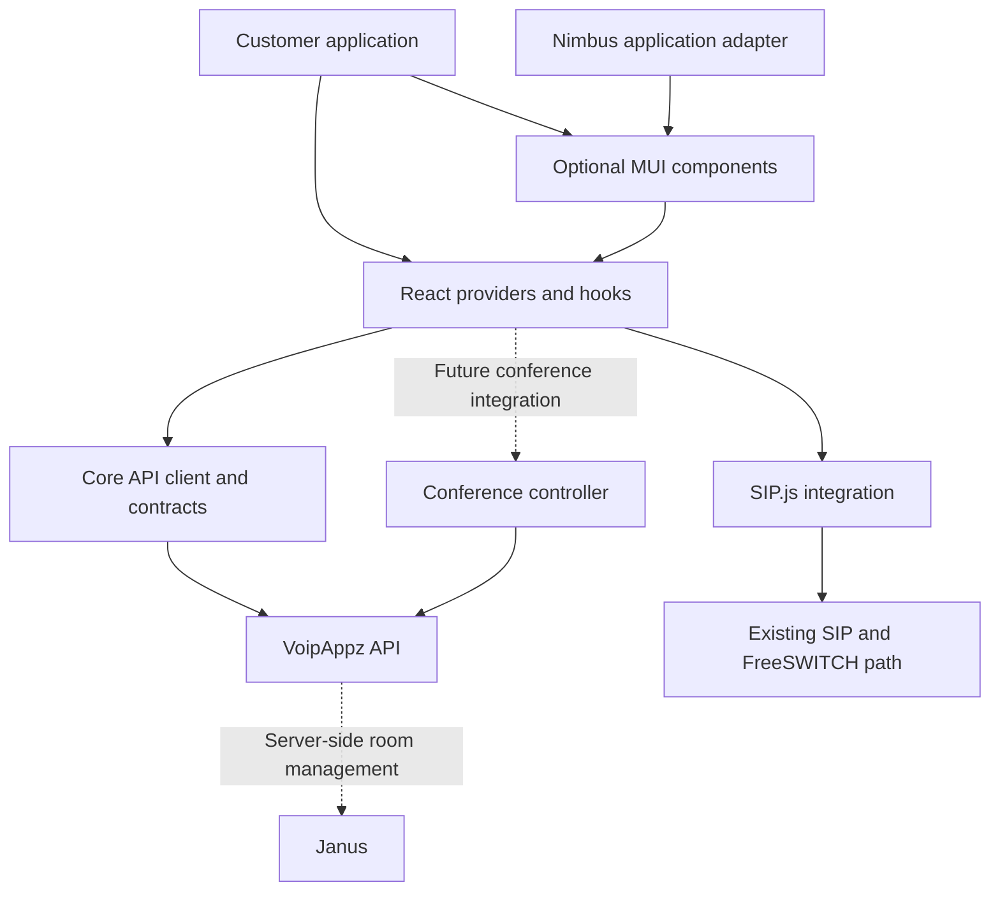

# VoipAppz customer platform: reusable building blocks

Research date: 14 October 2026. Status: proposed architecture and delivery plan.

**Objective**

Let each customer assemble their own application from VoipAppz capabilities: a call button inside a CRM, a complete phone, a contacts-and-history workspace, or an audio conference interface. Customers choose their layout, branding, navigation and authentication integration. Nimbus must consume the same supported building blocks.

“Like Lego” means independently useful features with consistent interfaces, predictable behavior and documented ways to connect them. It does not mean publishing every internal Nimbus component. Begin with React + MUI and expand feature coverage gradually.

This document contains research findings, proposed decisions, concrete extraction targets and release gates. Package names and code examples are proposals, not existing published APIs. No SDK implementation, package publication or deployment accompanies this document.

**Research method and limits**

Reviewed public GitHub repositories and package manifests, official React/MUI/Vite/npm documentation, Google's Material Design and API guidance, accessibility guidance, and relevant Nimbus source. Findings describe architectural patterns; they are not performance benchmarks or endorsements of another communications backend. External repositories were inspected, not installed or executed. GitHub default-branch links can change; pin any source revision before adopting code.

The local review used the Nimbus checkout and a documentation worktree based on `origin/main` at `c1d6a0b`. At the user's request, this document is included on `feat/nimbus-phone-ux-review` alongside the [phone UX review notes](phone-ux-review.md). The phone UX implementation is not a prerequisite for evaluating this architecture. A later SDK implementation should rebase on the then-current main branch and coordinate overlapping phone changes.

**What established projects demonstrate**

| Reference | Observed pattern | Proposed application to VoipAppz |
|---|---|---|
| [LiveKit components](https://github.com/livekit/components-js), [React package manifest](https://github.com/livekit/components-js/blob/main/packages/react/package.json) | Separate core/React packages, public hooks and prefab exports, type declarations and peer dependencies. | Offer both complete features and smaller hooks/components. Customers should not need a full page or app shell. |
| [Stream Video SDK](https://github.com/GetStream/stream-video-js), [React package manifest](https://github.com/GetStream/stream-video-js/blob/main/packages/react-sdk/package.json) | Client, React bindings and UI concerns are represented in distinct packages; styles have explicit packaging. | Separate communications state from presentation; make styling behavior explicit. |
| [React-admin](https://github.com/marmelab/react-admin), [core manifest](https://github.com/marmelab/react-admin/blob/master/packages/ra-core/package.json), [MUI manifest](https://github.com/marmelab/react-admin/blob/master/packages/ra-ui-materialui/package.json) | Core and Material UI layers are separate. Data providers translate application operations to backend requests. | Define adapters at the application boundary instead of importing Nimbus services into every block. |
| [Refine](https://github.com/refinedev/refine) | A headless approach makes application logic usable with different UI integrations. | Customers may build their own UI using our React hooks; MUI components remain optional. |
| [Twilio React video example](https://github.com/twilio/twilio-video-app-react) | SDK events feed React hooks and contexts, with event subscriptions cleaned up. | Keep one authoritative communications state and subscribe to it rather than duplicating it across widgets. |
| [MUI component customization](https://mui.com/material-ui/customization/overriding-component-structure/) and [composition](https://mui.com/material-ui/guides/composition/) | Named slots, slot props and composition provide explicit customization points. | Let customers replace selected headers, actions and empty states without forking our components. |

These are patterns to adopt selectively. Keep SIP.js, Janus, FreeSWITCH, Ruby and Crystal. Do not install LiveKit, Stream, React-admin or Refine merely to obtain their architecture. Do not copy their build systems or expose their internal APIs as ours.

**Customer integration levels**

| Level | Customer wants | Deliverable |
|---|---|---|
| Complete feature | “Put a phone in my application.” | `Phone`, with documented configuration and events. |
| Compose components | “Put history on the left and call controls on the right.” | Independently placeable `Dialpad`, `CallControls`, `CallHistory` and `ContactPicker`. |
| Custom interface | “Use our own design.” | React providers and hooks with no MUI requirement. |
| API integration | “Use our own frontend or backend.” | Framework-independent HTTP client and canonical API contract; browser calling still requires the browser communications integration. |

The first release supports a React application. An iframe, Web Component, native mobile SDK, visual page builder or arbitrary plugin marketplace is a separate product decision, not a requirement for the first reusable library.

**Architecture and package boundaries**

Use three initial packages in the existing repository. Start with one release train; use feature subpath exports rather than creating a package for every button.

| Proposed package | Owns | Must not depend on |
|---|---|---|
| `@voipappz/core` | Configurable HTTP client, resource methods, normalized errors and shared domain contracts. | React, MUI, Nimbus routing, browser storage or an implicitly selected user. |
| `@voipappz/react` | Providers, feature hooks, lifecycle integration and the existing SIP.js implementation behind a phone interface. | MUI, Nimbus auth contexts, dashboard components or a mandatory router. |
| `@voipappz/mui` | Presentational components and ready-made feature compositions using the hooks. | Nimbus app shell, direct token lookup or backend administration secrets. |



The first extraction does not require rewriting `useSipPhone` into a framework-independent engine. Preserve its tested behavior inside the React package. Extract a standalone communications engine only when another supported consumer needs it. Core's HTTP operations can be framework-independent immediately.

Use npm workspaces for linked development and Vite library mode for distribution. Both are supported by the existing tools. No Nx, Turborepo, new package manager or new state framework is needed for this scope. [npm workspaces](https://docs.npmjs.com/cli/v11/using-npm/workspaces/), [Vite 6 library mode](https://v6.vite.dev/guide/build#library-mode)

**What must change in Nimbus**

Paths below are relative to the repository root and describe inspected code, not completed extraction work.

| Current location | Coupling found | Extraction action |
|---|---|---|
| `src/context/SoftphoneContext.jsx` | Reads both Nimbus authentication contexts and persisted SIP settings. | Introduce explicit session/configuration inputs; retain a Nimbus adapter for its existing login behavior. |
| `src/lib/sip/useSipPhone.js` | Working React/SIP.js lifecycle with call reducers, reconnect and transfer handling. | Preserve this implementation first; expose a documented interface without exporting raw SIP.js sessions. |
| `src/lib/sip/config.js` and `sipSettings.js` | Vite environment variables, fixed storage keys and credential persistence. | Pass runtime configuration; make storage an optional injected adapter. Keep environment interpretation in the host app. |
| `src/components/Phone/PhoneScreen.jsx` | Combines drawer/navigation, settings, history and active-call rendering. | Separate the phone body and controls from Nimbus's drawer and navigation callbacks. |
| `src/components/Phone/PhoneCallsTab.jsx` | Uses Nimbus permissions, API services and a dashboard mapper. | Move resource mapping into shared contracts/adapters; receive permission and selection behavior explicitly. |
| `src/components/Phone/panelTheme.js` | Fixed panel colors. | Translate to MUI semantic theme values with a Nimbus preset. |
| `src/services/apiService.js` | Shared browser token lookup, logout handling and window integrations. | Add an instance-based customer client; migrate Nimbus through an adapter rather than exporting this singleton. |
| `src/services/sessionIsolation.js` | Encodes Nimbus's mutually exclusive admin/user sessions and clears personal browser storage. | Preserve that host policy in Nimbus; customer SDK instances must not clear unrelated application storage. |

**The contract every reusable block must satisfy**

| Concern | Required behavior |
|---|---|
| Data | Document the input model, IDs, pagination and supported actions. Share models across hooks and components. |
| State | Define loading, empty, ready, error and unavailable behavior. Call controls also reflect pending operations and actual call state. |
| Integration | Expose callbacks for selection/navigation. Do not change the host's URL or open a Nimbus sidebar internally. |
| Customization | Support `sx`, documented slots/slot props, accessible labels and a small set of meaningful props. |
| Authorization | Distinguish unsupported features from actions denied to the current user. Backend authorization remains authoritative. |
| Lifecycle | Mounting another visual block must not create another registration, duplicate audio output or steal the microphone. |
| Ownership | Document which provider owns the client/session and who disposes it. Unmounting a dialpad must not end a call. |
| Isolation | Scope cache keys and subscriptions to client, environment and identity. Cancel stale requests and discard late events after logout/switch. |
| Accessibility | Preserve keyboard operation, focus behavior, meaningful status announcements and usable mobile controls. |
| Documentation | Include imports, prerequisites, examples, error behavior, supported versions and an independent consumer test. |

A presentational `CallControlsView` can accept state/actions as props; a connected `CallControls` can obtain the same contract from context. Keep the presentation logic shared. Use composition for layouts instead of accumulating dozens of unrelated boolean configuration flags.

MUI's themeable-component guidance supports named component customization and defaults. Forward supported refs and DOM props, and compose event handlers so a customer's customization does not silently remove required behavior. [MUI themed components](https://v7.mui.com/material-ui/customization/creating-themed-components/), [MUI composition](https://mui.com/material-ui/guides/composition/)

**Proposed customer experience**

The following is an illustrative public interface, not runnable code from a released package. `platform` is created once by the host application with its runtime configuration and supported session callbacks; it is disposed when that host session ends. `customerTheme` is the customer's MUI theme.

```jsx
import { ThemeProvider } from '@mui/material/styles';
import { VoipAppzProvider } from '@voipappz/react';
import { Phone } from '@voipappz/mui/phone';

export function CustomerWorkspace({ platform, customerTheme }) {
  return (
    <ThemeProvider theme={customerTheme}>
      <VoipAppzProvider client={platform}>
        <Phone />
      </VoipAppzProvider>
    </ThemeProvider>
  );
}
```

The same provider should support a composed screen:

```jsx
<Stack direction={{ xs: 'column', md: 'row' }} spacing={2}>
  <CallHistory onSelect={openCustomerCallDetails} />
  <Stack spacing={2}>
    <Dialpad />
    <CallControls />
  </Stack>
</Stack>
```

These blocks share the same selected call and phone instance. A history-only application must be able to use history without initializing a phone or importing SIP.js into its bundle. A customer using hooks alone must not need MUI.

**Runtime configuration, identity and API behavior**

Define a small explicit configuration surface: API base URL, current session/identity, token retrieval callback, optional fetch implementation, locale and optional diagnostics callback. Supply SIP credentials and WSS/ICE configuration separately from API tokens. The SDK must not infer them from Nimbus's local-storage keys or build-time `VITE_*` values.

Keep customer credentials in memory by default. A browser phone requires scoped SIP credentials at runtime; Janus administration secrets do not belong in the browser. Establish which current backend credential flows are suitable before the preview release. Do not document a new token-exchange or capability endpoint as available until it actually exists.

Token refresh should have one owner and coalesce concurrent refresh attempts. Return typed authentication/permission errors to the host rather than globally redirecting or logging out unrelated sessions. On identity changes, dispose old subscriptions, clear that instance's cache and prevent old asynchronous results from entering the new session.

Resource methods should normalize API results at one boundary. The Ruby API's canonical OpenAPI remains the authority; do not maintain a conflicting contract inside React. Reuse current pagination semantics first. If new list endpoints are added, define ordering and pagination from the beginning. Google recommends anticipating pagination and treating compatibility as a behavioral contract, not just unchanged field names. This informs new API work; it does not require changing existing endpoints to Google's conventions. [Google AIP-158](https://google.aip.dev/158), [Google AIP-180](https://google.aip.dev/180)

Use bounded retries only where an operation is safe to repeat. Do not automatically retry call creation, transfers or room creation after an ambiguous timeout without backend support for deduplication or reconciliation. Expose an error code, safe message, retryability and request correlation where available.

An adapter is a practical integration boundary: React-admin's data-provider design translates shared operations into API-specific requests and responses. Our telephony actions should still have explicit domain methods rather than being forced into generic CRUD. [React-admin data providers](https://marmelab.com/react-admin/DataProviders.html)

**Calling, conferences and multiple consumers**

One configured phone instance owns registration, media and call state. Multiple visual consumers subscribe to it. Multiple authenticated clients must be isolated, but registering the same extension in several tabs/devices is a separate signaling/product policy; component reuse does not solve it automatically.

Preserve the current call reducer and transfer state ownership. If an external store is introduced later, React's `useSyncExternalStore` is the native subscription interface; it requires stable snapshots and cleanup. Do not add a new state library solely for packaging. Verify setup/cleanup under Strict Mode. [React external stores](https://react.dev/reference/react/useSyncExternalStore), [React Strict Mode](https://react.dev/reference/react/StrictMode)

A stable event contract should include call identity and distinguish registration state, call state and command failures. Avoid a second, independently updated copy of the call state in every widget. SDK internals and raw SIP/Janus objects should remain replaceable behind this interface.

Importing a package must not request microphone access, connect a socket or register a phone. Connect only through the configured lifecycle, and acquire media through supported user actions. Show actionable microphone-denied and audio-playback-blocked states. Secure-context and browser permission requirements must be covered in the customer guide. [MDN media permissions](https://developer.mozilla.org/en-US/docs/Web/API/MediaDevices/getUserMedia)

Janus remains a staged extension. The existing audio-room API foundation does not supply a finished participant UI, active-call conversion or verified browser-to-multiple-phone audio. First complete the FreeSWITCH/mod_janus/Lua path and live audio checks. Then define conference hooks and controls against proven backend behavior.

AudioBridge and VideoRoom are distinct Janus plugins. Video requires its own participant/media lifecycle and an explicit policy preventing duplicate microphone/audio paths when combined with SIP audio. Treat video as a separate capability and release gate. [Janus AudioBridge](https://janus.conf.meetecho.com/docs/audiobridge.html), [Janus VideoRoom](https://janus.conf.meetecho.com/docs/videoroom.html)

**Theme, language and accessible UX**

Use semantic tokens such as surface, text, primary action, danger and focus. Keep Nimbus branding as one preset; do not hardcode it into customer components. Google's Material guidance describes tokens as shared values across design and implementation. Apply that principle through the existing MUI theme; a Material 3 migration is not required. [Google Material foundations](https://m3.material.io/foundations/)

Inherit the host's theme. Avoid injecting a global CSS reset, loading fonts automatically, or modifying the host's document styles. A standalone demo may opt into its own baseline. Provide scoped English/Hebrew messages and a translation integration option; do not change the host's global i18n instance on import.

Check narrow containers, not only full browser widths. Keep numbers and SIP identifiers readable in RTL. Explicitly handle direction on portaled menus/dialogs, and preserve focus when dialogs open and close. [MUI RTL](https://v7.mui.com/material-ui/customization/right-to-left/), [W3C dialog pattern](https://www.w3.org/WAI/ARIA/apg/patterns/dialog-modal/)

Do not encode call state only by color. Label actions, show pending commands, explain unavailable operations, and announce meaningful state transitions without announcing the timer every second. Each supplied composition must include loading, empty, failure and permission-denied examples.

**Packaging and compatibility**

Publish documented ESM entry points and TypeScript declarations. Keep the existing JavaScript implementation where practical; type the public boundary without a repository-wide TypeScript rewrite. Add CommonJS only if a supported consumer requires it. Use explicit `exports` and a publication file allowlist. [Node package entry points](https://nodejs.org/api/packages.html#package-entry-points)

Keep React/ReactDOM as peer dependencies. The MUI layer also shares compatible MUI/Emotion instances with the host. Externalize those imports, including relevant subpaths, from builds. Duplicate React can break hooks. Start with the repository's React 19/MUI 7 line and declare only compatibility combinations tested in CI; do not upgrade the app just because current documentation covers a newer major. [React duplicate-instance guidance](https://react.dev/warnings/invalid-hook-call-warning), [Vite library mode](https://v6.vite.dev/guide/build#library-mode)

Keep optional feature imports independent. Verify that a history-only consumer excludes SIP/Janus/video code and that a hooks-only consumer excludes MUI. Mark side effects truthfully: required CSS must not disappear during tree shaking. Verify the packed artifact, not just workspace source links.

Use preview versions before a stable public contract. Publish changelogs and migration instructions; after 1.0, treat incompatible public changes as major releases. Capture supported backend contract versions as well as frontend dependencies. [Semantic Versioning](https://semver.org/)

Before publication, settle package ownership, registry visibility, support expectations and distribution rights. Review any third-party code/assets before copying them; this research proposes architectural patterns, not copied assets. Use the registry's supported provenance mechanism where applicable to connect releases to their source/build. [npm provenance](https://docs.npmjs.com/generating-provenance-statements/)

**Feature catalogue and delivery order**

| Stage | Reusable blocks | Boundary or dependency |
|---|---|---|
| First slice | Phone, dialpad, call status, mute/hold/end, existing transfer controls | Existing SIP.js behavior with explicit session configuration. |
| Customer workspace | Call history, contact selection, contact details, availability | Verified customer API permissions and shared data models. |
| Audio conferences | Conference entry, participants, invite/leave and authorized moderation | Completed API/node integration and real multiphone audio. |
| Further platform features | Recordings, messaging, numbers, reports and customer settings | Separate API/readiness and permission review for each feature. |
| Video | Video tiles, device selection, camera and screen sharing | Proven VideoRoom integration and media ownership model. |

Administration-only capabilities stay outside the default customer surface. They can later become explicit packages or subpaths with their own permissions and support contract. A customer feature should not pull the whole admin application into its dependency graph.

**Implementation work packages and acceptance gates**

| Work package | Deliverable | Acceptance gate |
|---|---|---|
| 1. Public interface design | Feature inventory, package exports, state/action models, auth/configuration and ownership contracts. | Reviewers can explain how a customer uses one block without Nimbus. |
| 2. Phone extraction | Providers/hooks and MUI phone blocks with a Nimbus adapter. | Existing call/transfer behavior preserved; removing a visual block does not drop the session. |
| 3. Independent consumer | A small customer React + MUI application installed from package tarballs. | No imports from Nimbus source, no Nimbus auth/router requirement, custom theme works. |
| 4. Nimbus adoption | Nimbus imports the same packages; legacy internals are migrated incrementally. | No duplicated phone implementation and existing regressions remain green. |
| 5. Customer preview | README, API reference, composition recipes, troubleshooting and compatibility matrix. | Another developer completes setup from documentation; package contents and declarations verified. |
| 6. Feature expansion | History/contacts, then verified conferences and later video. | Each module meets the same isolation, lifecycle, permission and usability gates. |

Use a separate SDK implementation branch/worktree. Keep UI design changes independently reviewable. Backend semantics and canonical contract changes belong in `voipappz-api`; FreeSWITCH/Lua/runtime work belongs in `va-crystal`. Split PRs by independently testable behavior rather than attempting a full-platform rewrite.

**Verification plan**

Nimbus's current repository policy permits only `npm run lint` locally. The checks below are proposed CI or designated integration-environment work, not tests run while writing this document.

| Area | Required evidence |
|---|---|
| Package consumption | Install packed artifacts into a clean customer example; resolve exports/types without workspace aliases; inspect published file list. |
| Dependencies | One compatible React/MUI setup; hooks-only and history-only bundles exclude unrelated engines/UI; record size baselines before setting budgets. |
| State/lifecycle | Strict Mode mount/cleanup, two widgets sharing one call, late events, logout, identity switch, reconnect and disposal. |
| API/auth | Correct environment/token, denied permissions, expired sessions, cancellation, pagination and ambiguous mutation failures. |
| UI | Real browser keyboard/focus checks, screen-reader-oriented labels, English/Hebrew, narrow/short containers, light/dark/custom themes. |
| Existing phone | Incoming/outgoing calls, answer/decline, mute, hold/resume, DTMF and blind/attended transfer including cancel. |
| Live media | At least two independent phones/browsers; verify audible media both ways, leave/rejoin, network interruptions and device/permission failures. A signaling success alone is insufficient. |
| Conferences/video | Capability-specific tests only after backend implementation; confirm participants and avoid duplicated media paths. |
| Host coexistence | No forced router, global CSS reset, shared storage cleanup, duplicate notifications or unexpected microphone/network access. |

Keep an example gallery within the existing React/Vite tooling initially. Storybook or additional test frameworks are optional future choices only if a concrete maintenance need justifies them.

**Release decisions still to resolve**

- Select the first external customer application and supported browser/framework combinations. Use a React + MUI example first; add an SSR consumer before claiming SSR compatibility.
- Confirm the backend-supported method for obtaining scoped API/SIP credentials, cross-origin access and environment identity.
- Define extension behavior across tabs/devices; multiple UI widgets sharing a session is not the same feature as multiple simultaneous calls or registrations.
- Confirm which customer operations are actually supported and permissioned; capability discovery may need backend work.
- Choose package visibility and distribution ownership before publishing; no publication is implied by this research.
- Assign maintainers and support/version policy before making stable compatibility promises.

**Definition of done for the first release**

A customer developer installs the preview packages into a clean React + MUI application, supplies supported runtime authentication/configuration, applies their own theme, and makes a call. They can replace the full phone with individual controls without rewriting signaling. Nimbus uses the same implementation. CI verifies both consumers, and a live test verifies actual audio. Customer docs clearly distinguish available features from planned Janus/video extensions.
